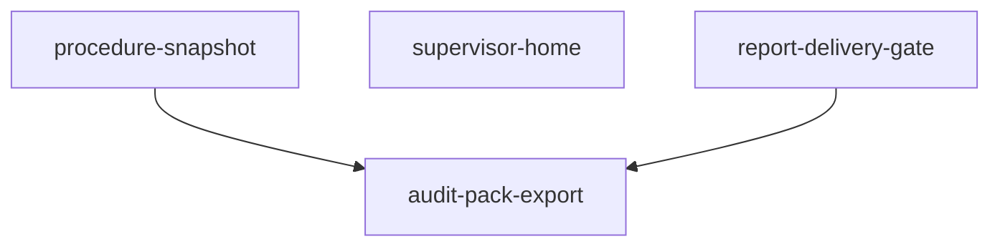

# Capability Map: P0 Trust Surfaces (Wave A)

**Initiative:** MysticNDT — Supervisor home, procedure snapshot, audit pack  
**Requirements Pack:** [docs/packs/NDT-PACK-p0-trust-surfaces.md](../packs/NDT-PACK-p0-trust-surfaces.md)  
**Status:** APPROVED by user — 2026-09-13 (capability map)  
**Implementation:** P0 slices built — Reset demo to load `ndt_jobs_v8`  
**Stack:** frontend + seed/localStorage only

## Modules

| Module id | Responsibility | Depends on | Pack rules touched |
|-----------|----------------|------------|--------------------|
| `procedure-snapshot` | Freeze WEP + criteria onto job on Assign / first Start; field UI + PDF read snapshot; replace-revision + audit | — (extends Job + procedure types) | 10–14, snapshot parts of 16 |
| `supervisor-home` | First-class supervisor queue (`Awaiting Supervisor` primary, `Revision Required` secondary); open existing JobDetailView | — (uses existing job states; no snapshot required) | 5–9, shared 1–4 |
| `report-delivery-gate` | Job fields + minimal Mark delivered UI; gate = L3-approved OR Admin final-without-L3 + reason | — (job/report model) | 18–20 |
| `audit-pack-export` | Export evidence bundle (PDF + findings/history + equipment + certs + snapshot + audit); Final vs field-complete labeling | `procedure-snapshot`, `report-delivery-gate` (for Final labeling / delivery status in pack) | 15–17, 16 |

## Dependency graph

- `supervisor-home` is **independent** of snapshot/delivery (can ship in parallel with slice 1 conceptually; sequenced below for clean demos).
- `audit-pack-export` consumes snapshot data and Final/delivery status — build **after** those two.

## Build order (recommended)

1. **`procedure-snapshot`** — Foundation for correct reports/criteria; unlocks honest audit pack contents.  
2. **`supervisor-home`** — Highest buyer-visible ISO 9712 handoff win; no dependency on (1). Placed second so Assign/Start snapshot exists before heavy demo scripting.  
3. **`report-delivery-gate`** — Small model + thin UI; unlocks Final delivery semantics for pack labeling.  
4. **`audit-pack-export`** — Capstone evidence download using (1)+(3).

**Parallel note:** After (1) types exist, (2) and (3) could be built in either order; keep this sequence unless you override.

## Out of map (Wave B — not these modules)

- Dispatch board  
- Renewals hub  
- Vision / employer authorization hard-block  

## Spec files (to write after map approval)

| Module id | Spec path |
|-----------|-----------|
| `procedure-snapshot` | `docs/specs/SPEC-procedure-snapshot.md` |
| `supervisor-home` | `docs/specs/SPEC-supervisor-home.md` |
| `report-delivery-gate` | `docs/specs/SPEC-report-delivery-gate.md` |
| `audit-pack-export` | `docs/specs/SPEC-audit-pack-export.md` |

## Success for this gate

User approves: module ids, dependency direction, and build order — then Spec-Driven writes module specs in order (or first-wave batch for review).
