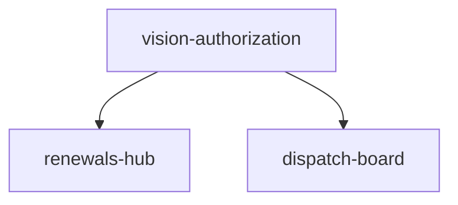

# Capability Map: P1 Ops Surfaces (Wave B)

**Initiative:** MysticNDT — Vision/authorization, renewals hub, dispatch board  
**Requirements Pack:** [docs/packs/NDT-PACK-p1-ops-surfaces.md](../packs/NDT-PACK-p1-ops-surfaces.md)  
**Status:** APPROVED with pack — 2026-09-14  
**Stack:** frontend + seed/localStorage only

## Modules

| Module id | Responsibility | Depends on | Pack rules |
|-----------|----------------|------------|------------|
| `vision-authorization` | Inspector vision expiry + employerAuthorized; registrar UI; eligibility hard-block/warn; seed demos | — | 5–11 |
| `renewals-hub` | Admin unified renewals list (method certs, cal, vision) + filters + open profile/equipment | `vision-authorization` | 12–16 |
| `dispatch-board` | Admin week board of open jobs; assign via JobForm/eligibility including vision | `vision-authorization` | 17–22 |

## Dependency graph

## Build order
1. `vision-authorization`  
2. `renewals-hub`  
3. `dispatch-board`

## Spec files

| Module id | Spec path |
|-----------|-----------|
| `vision-authorization` | `docs/specs/SPEC-vision-authorization.md` |
| `renewals-hub` | `docs/specs/SPEC-renewals-hub.md` |
| `dispatch-board` | `docs/specs/SPEC-dispatch-board.md` |
